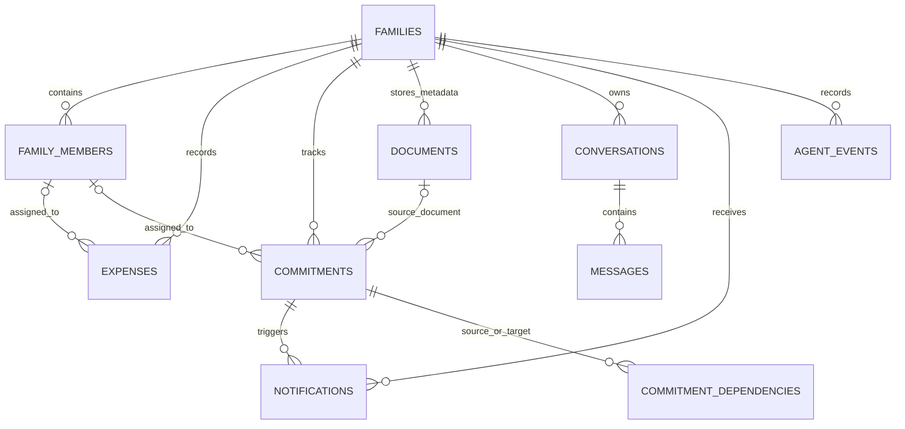

# Database Design

The database layer uses SQLAlchemy async models with PostgreSQL and Alembic migrations. Model definitions are under `backend/app/models/`; the migration history is under `backend/alembic/versions/`.

## Main tables

| Table | Purpose | Main relationships |
|---|---|---|
| `families` | Household identity and timezone | Parent of members, expenses, commitments, documents, dependencies, and notifications |
| `family_members` | People in a family and their roles/active state | Belongs to a family; may be assigned expenses, commitments, or uploaded documents |
| `expenses` | Recorded household spending | Belongs to a family; optionally assigned to a member |
| `commitments` | Bills, tasks, appointments, tests, renewals, and deadlines | Belongs to a family; may be assigned to a member and optionally linked to a source document |
| `commitment_dependencies` | Directed prerequisite relationships between commitments | Links source and target commitments; records dependency type and family scope |
| `documents` | Uploaded file metadata, extraction output, and processing status | Belongs to a family; may have an uploader and commitments created from it |
| `conversations` | Chat conversation associated with a family | Belongs to a family; contains ordered messages |
| `messages` | Persisted conversation messages | Belongs to a conversation; sequence numbers are unique per conversation |
| `notifications` | Persisted attention items and resolution state | Belongs to a family; may reference a commitment |
| `agent_events` | Structured agent execution/observability events | Belongs to a family |

## Relationship sketch



## Integrity and query considerations

- Family ownership is carried by `family_id` on the principal household tables and is checked in service/repository code.
- Foreign keys use cascade behavior for family-owned child records where configured; member/document links may use `SET NULL` so historical records can remain.
- Expense amounts must be positive. Commitment amounts, when present, must be positive.
- Commitment dependencies reject self-links, enforce uniqueness of the source/target/type combination, and are checked for invalid cycles in the service layer.
- Messages have a per-conversation sequence number and uniqueness constraint to preserve ordering.
- Indexes target common filters such as family, member, status, due date, category, document type, notification state, and event time.
- Dates are stored as date values for expenses/commitments, with timezone-aware timestamps for creation/update events. Date interpretation is configured by `FAMILY_TIMEZONE` (default `Asia/Kolkata`).

## Migrations

Apply existing migrations with:

```bash
alembic -c backend/alembic.ini upgrade head
```

For a new schema change, update the model, generate a migration with Alembic, inspect the generated operations, and commit the model and migration together. Do not rely on ad hoc schema edits for reproducible environments.
