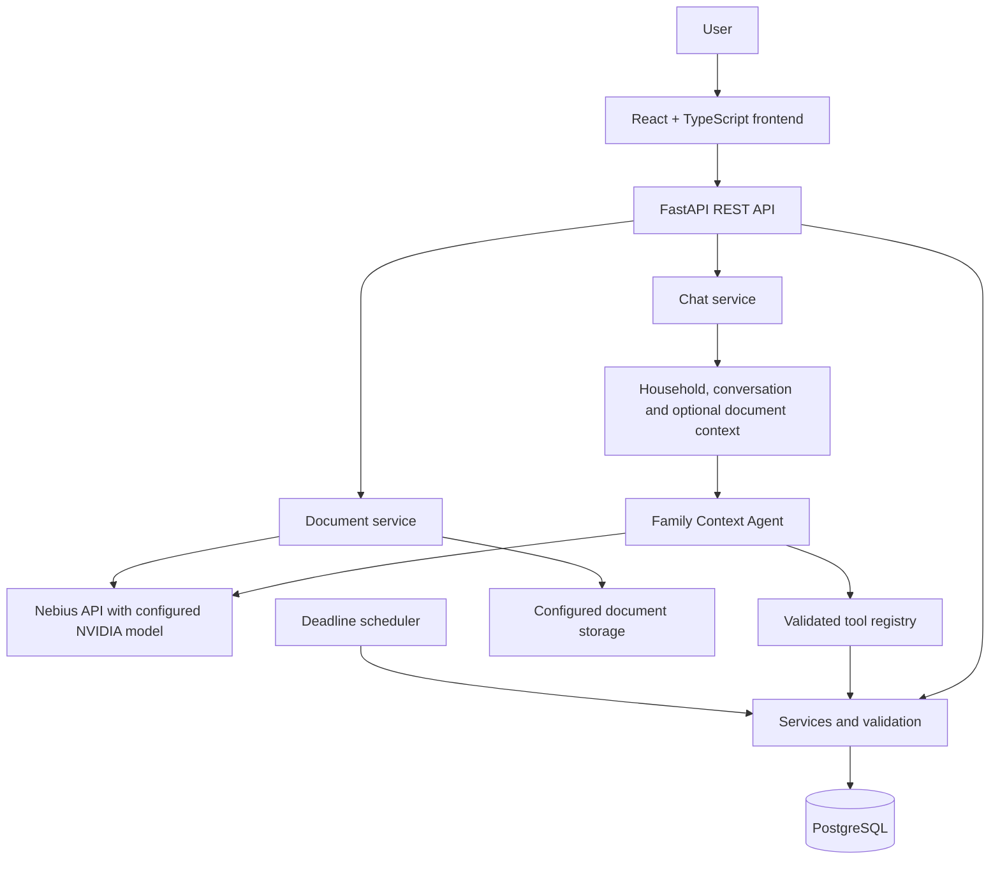

# Famora AI — Family Context Agent

Famora AI is an AI-powered family assistant that helps households organize expenses, commitments, appointments, deadlines, dependencies, and documents in one place. It combines a React/TypeScript frontend, FastAPI backend, PostgreSQL database, and an agent that calls NVIDIA models through the Nebius API.

This repository includes the application, database migrations, automated tests, a fictional Judge Mode scenario, and engineering design references.

## Contents

- [Problem and solution](#problem-and-solution)
- [Features](#features)
- [Architecture](#architecture)
- [Technology stack](#technology-stack)
- [NVIDIA and Nebius integration](#nvidia-and-nebius-integration)
- [Run with Docker](#run-with-docker-recommended)
- [Run locally](#run-locally)
- [Environment variables](#environment-variables)
- [Database and migrations](#database-and-migrations)
- [Demo walkthrough](#demo-walkthrough)
- [Testing](#testing)
- [Additional documentation](#additional-documentation)
- [Known limitations](#known-limitations)
- [License](#license)

## Problem and solution

Family information is often scattered across messages, bills, receipts, appointments, and individual memory. It can be difficult to know who owns a task, when a bill is due, how much was spent during a period, or which task must happen before another.

Famora AI provides a shared place to manage this context. Users can ask questions in natural language, view structured records, track dependencies, and upload documents for extraction. The backend provides household and conversation context to the agent, validates its requested actions, executes only registered tools through the service layer, and returns the real tool results to the model. Priorities are calculated by application rules from dates, statuses, and dependencies—not left to the language model to calculate freely.

## Features

- **Family and member management** for household context and task ownership.
- **AI chat** for household questions and supported actions.
- **Expense tracking** with database-calculated totals and summaries.
- **Commitments** for bills, tasks, appointments, lab tests, renewals, and deadlines.
- **Timeline** for chronological commitments, with optional date and member filters.
- **Dependencies** representing that one commitment must be completed before another.
- **Priorities and notifications** with reasons for items requiring attention.
- **Document workflow:** PDF/JPEG/PNG upload, extraction of text and proposed fields, review, and explicit confirmation before a commitment is created from a document.
- **Demo Playground / Judge Mode** to load fictional household scenarios.
- **Scheduled deadline checks** through APScheduler.
- **Agent event records** for basic execution observability.
- **Swagger / OpenAPI** documentation generated by FastAPI.

## Architecture



The principal backend layers are **API → service → repository → database**. The agent receives application context and tool schemas, may request a registered tool, and receives its result before generating a response. Tool inputs are validated with Pydantic and the tool registry. The agent loop is bounded; the model client handles provider errors, malformed responses, and request timeouts.

## Technology stack

| Area | Technologies |
|---|---|
| Frontend | React 18, TypeScript, Vite, React Router, TanStack Query, Axios, Tailwind CSS, Lucide |
| Backend | Python, FastAPI, Pydantic Settings |
| Database | PostgreSQL, SQLAlchemy async, asyncpg |
| Migrations | Alembic |
| AI | Nebius API-compatible chat completions; configured NVIDIA text and vision models |
| Documents | pypdf, Pillow, multipart upload, Supabase Storage adapter |
| Background jobs | APScheduler |
| Tests and quality | pytest, pytest-asyncio, pytest-cov, Ruff, mypy, Vitest, Testing Library, ESLint |
| Containers | Docker, Docker Compose, Nginx |

## NVIDIA and Nebius integration

The backend `AIModelClient` sends chat-completion requests to `NEBIUS_BASE_URL`, authenticates with `NEBIUS_API_KEY`, and selects `NVIDIA_MODEL_NAME`. Requests include the registered function-tool definitions using the compatible tool-calling format. Document processing uses the configured `VISION_MODEL_NAME` to propose extracted fields from uploaded PDFs and images.

A valid API key, available model identifier, and reachable endpoint are required for AI chat and model-based extraction. For document upload with the current dependency wiring, configure `SUPABASE_URL` and `SUPABASE_SERVICE_ROLE_KEY` and create the private `family-documents` bucket. Never commit API credentials or include them in screenshots or logs.

## Run with Docker (recommended)

### Prerequisites

- Docker Engine
- Docker Compose v2 (`docker compose`)
- A valid Nebius API key and an available model identifier

### 1. Configure the environment

From the repository root:

```bash
cp .env.example .env
```

Edit `.env` and set `NEBIUS_API_KEY` and `NVIDIA_MODEL_NAME`. For the document upload flow, the current API dependency wiring initializes `SupabaseStorage`, so also set `SUPABASE_URL` and `SUPABASE_SERVICE_ROLE_KEY` and provision the private `family-documents` bucket. Review the example PostgreSQL password before using anything beyond a local demo.

### 2. Start the stack

```bash
docker compose up --build
```

To run in the background:

```bash
docker compose up --build -d
```

Compose starts PostgreSQL 16, waits for its health check, applies Alembic migrations in the backend container, and starts the API and frontend after their dependencies are healthy.

### 3. Open the services

- Frontend: http://localhost:5173
- Backend health (includes database status): http://localhost:8000/health
- Swagger UI: http://localhost:8000/docs
- OpenAPI schema: http://localhost:8000/openapi.json
- Health through the frontend proxy: http://localhost:5173/api/v1/health

### 4. Operate the stack

```bash
docker compose ps
docker compose logs --tail=100 backend
docker compose down
```

PostgreSQL data and uploaded documents use named Docker volumes. `docker compose down` preserves them; `docker compose down -v` deletes them and should only be used when you intentionally want to remove persisted data.

## Run locally

Docker is the recommended path. To run without Docker, install PostgreSQL locally and set `DATABASE_URL` to the local database host (usually `localhost`, not the Compose-only hostname `db`).

### Backend

From the repository root:

```bash
python3.12 -m venv .venv
source .venv/bin/activate
pip install -r backend/requirements-dev.txt
cp .env.example .env
```

Edit `.env` with your local PostgreSQL URL and Nebius credentials. The backend reads the root `.env` file. Then run:

```bash
alembic -c backend/alembic.ini upgrade head
uvicorn app.main:app --app-dir backend --reload --host 0.0.0.0 --port 8000
```

### Frontend

In a second terminal:

```bash
cd frontend
cp .env.example .env
npm ci
npm run dev
```

Vite serves the frontend at http://localhost:5173 and proxies `/api` requests to `http://localhost:8000`.

## Environment variables

The root `.env.example` lists the main configuration values. Backend settings are in `backend/app/core/config.py`; Docker Compose also supplies some values explicitly.

| Variable | Purpose |
|---|---|
| `NEBIUS_API_KEY` | Nebius API authentication |
| `NEBIUS_BASE_URL` | Model API base URL |
| `NVIDIA_MODEL_NAME` | Main chat/tool-calling model ID |
| `VISION_MODEL_NAME` | Model ID used for document extraction |
| `MODEL_TIMEOUT_SECONDS` | Model request timeout (backend default: 60 seconds) |
| `DATABASE_URL` | SQLAlchemy async PostgreSQL URL |
| `POSTGRES_DB`, `POSTGRES_USER`, `POSTGRES_PASSWORD` | PostgreSQL container settings |
| `POSTGRES_HOST`, `POSTGRES_PORT` | Database connection settings in the example file |
| `CORS_ORIGINS` | Comma-separated permitted browser origins |
| `FAMILY_TIMEZONE` | Date interpretation timezone (default: `Asia/Kolkata`) |
| `DEMO_FAMILY_NAME` | Demo household label |
| `UPLOAD_DIR` | Upload directory / container path |
| `MAX_UPLOAD_SIZE_MB` | Upload size limit (default: 10 MB) |
| `ALLOWED_UPLOAD_TYPES` | Allowed MIME types; default supports PDF, JPEG, PNG |
| `SUPABASE_URL`, `SUPABASE_SERVICE_ROLE_KEY` | Supabase Storage adapter credentials |
| `SCHEDULER_ENABLED` | Enables/disables the in-process deadline scheduler |
| `DEADLINE_CHECK_INTERVAL_MINUTES` | Scheduler interval (backend default: 60 minutes) |
| `VITE_API_BASE_URL` | Frontend API base URL; local example: `http://localhost:8000/api/v1` |

The checked-in Compose file maps PostgreSQL host port **5433** to container port **5432** and the backend connects to the Compose service `db`. Keep `.env` private. Any `VITE_*` value is bundled into browser code and must not contain secrets.

## Database and migrations

The database stores families, family members, expenses, commitments, commitment dependencies, documents, conversations, messages, notifications, and agent events. SQLAlchemy models are in `backend/app/models/`; versioned Alembic migrations are in `backend/alembic/versions/`.

Docker Compose runs `alembic upgrade head` before starting the backend. For a local setup, apply migrations from the repository root:

```bash
source .venv/bin/activate
alembic -c backend/alembic.ini upgrade head
```

Check the current revision:

```bash
alembic -c backend/alembic.ini current
```

After changing models, generate and review a migration before applying it:

```bash
alembic -c backend/alembic.ini revision --autogenerate -m "describe the schema change"
alembic -c backend/alembic.ini upgrade head
```

## Demo walkthrough

### Load a fictional family

1. Start the app and open **Demo Playground**.
2. Select an available scenario and load it.
3. Review Home, Chat, Timeline, Expenses, and Documents.
4. Ask questions about commitments, assignments, expenses, due dates, and prerequisites.
5. Reset the demo when you need to restore the baseline.

Demo API endpoints:

- `GET /api/v1/demo/scenarios` — list available scenarios.
- `POST /api/v1/demo/scenarios/{scenario_id}/load` — load a scenario.
- `POST /api/v1/demo/reset` — reset the Nair Family scenario.

Scenario JSON is loaded from `backend/synthetic_data/scenarios/`. The current checked-in scenario is `nair-family.json`; additional scenarios must follow the backend schema.

### Try a document

Demo documents are intended to live in the repository-root **`demo_documents/`** folder. Use PDF, JPG/JPEG, or PNG files. In the Documents page, upload a file for the selected household, review its processing status and proposed fields, and confirm the proposal before creating a commitment. You can then ask a chat question about the document and compare the answer with the source.

Example chat prompts (results depend on the loaded data):

- “What needs our attention this week?”
- “Record ₹1,850 for groceries today.”
- “The electricity bill is ₹3,240 and due on October 28, 2026.”
- “Show the expense total for groceries.”
- “Mark the electricity bill as completed.”
- “The blood test must happen before the doctor review.”

Verify state-changing actions in the UI or API; a generated reply alone is not proof that data was saved.

## Testing

### Backend

From the repository root:

```bash
pip install -r backend/requirements-dev.txt
pytest
```

Pytest is configured in `pyproject.toml` to discover tests under `backend/tests`. Tests are grouped into:

- `backend/tests/unit/` — model client, tool validation, services, repositories, date handling, documents, and upload behavior.
- `backend/tests/integration/` — chat/tool flows, PostgreSQL integration, family scoping, commitments, dependencies, scheduler, and failure handling.
- `backend/tests/scenarios/` — core scenarios and Judge Mode.

Integration tests require an appropriately configured test database and environment. Test files exist in the repository; this README does not claim they passed in the current environment.

### Frontend

```bash
cd frontend
npm ci
npm test
npm run lint
npm run build
```

Vitest uses jsdom and Testing Library. `npm run build` runs TypeScript checks and Vite bundling.

## Additional documentation

- [API reference and route guide](docs/API.md)
- [Database design](docs/DATABASE_DESIGN.md)
- [Agent and tool architecture](docs/AGENT_TOOL_ARCHITECTURE.md)
- [Evaluation status and reproducibility](docs/EVALUATION.md)
- [Deployment instructions](docs/DEPLOYMENT.md)
- [Project structure](docs/PROJECT_STRUCTURE.md)
- Original team design references: `design_docs/`

For live request/response schemas, run the backend and open http://localhost:8000/docs or http://localhost:8000/openapi.json.

## Known limitations

- AI chat and document extraction require a working Nebius endpoint, valid credentials, and an available model. Provider throttling, model changes, and network errors can affect these features.
- Extracted fields are model-generated proposals and can be incomplete or wrong. Review them before confirming a commitment.
- Accepted document types are PDF, JPEG, and PNG; extraction has page and text limits in the backend.
- The agent can call only registered tools. It does not perform payments or execute arbitrary SQL/code.
- The MVP dependency type is `MUST_COMPLETE_BEFORE`.
- The deadline scheduler runs in-process. In multi-worker deployments, enable it on only one worker to avoid redundant scheduled runs.
- Demo scenarios and uploaded documents are for demonstration; do not use sample data as real family records.
- Before using real household data in a public deployment, review authentication/authorization, HTTPS, secret management, backups, monitoring, access policies, and storage persistence.
- This hackathon project is not a substitute for qualified medical, legal, or financial advice.
